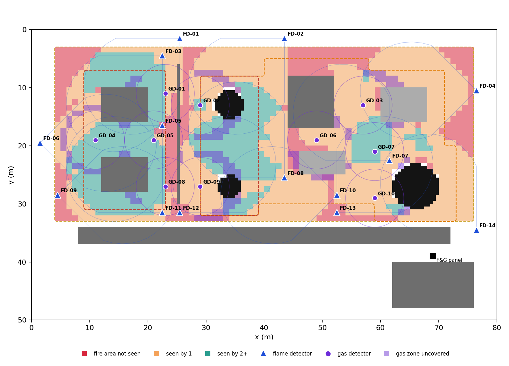
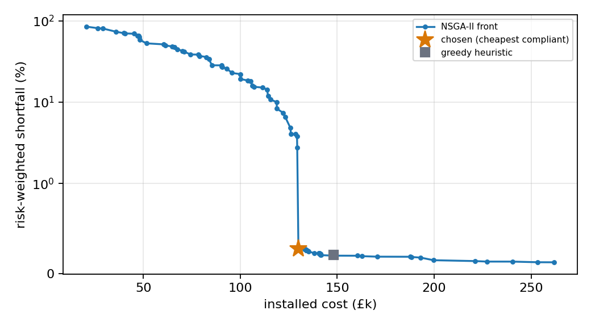

# DetectorPlace

**AI-assisted fire & gas detector placement, coverage validation and cost estimation.**

[](https://github.com/malikwaqas077/detectorplace/actions/workflows/ci.yml)

A working demonstrator built by Waqas Ahmad for the Teesside University × Protex (UK) Systems Knowledge Transfer
Partnership (KTP Associate, Software Engineer, ref T03269). It goes from a plot-plan drawing to an optimised,
explained and costed F&G detector layout:

```
plot-plan image ──► computer vision ──► 2.5D plant model ──► 3D line-of-sight coverage engine (Numba)
                                                                        │
       PDF design report ◄── explainability, N-1, gaps ◄── NSGA-II cost-vs-risk optimiser ◄─┘
                                                              (validated against greedy + exact MILP)
```

▶ **Demo video:** see the [v0.1.0 release](https://github.com/malikwaqas077/detectorplace/releases/tag/v0.1.0) (about 2 minutes)

> Everything here is synthetic: the plant is an invented gas compression station, and detector performance
> and cost figures are placeholders. The output is advisory and is not a substitute for a competent F&G engineer.



## Results on the demo plant

| | |
|---|---|
| Drawing → model (OpenCV) | equipment IoU **99.3%**, elevation bands 100% correct, hazard grades 98.6% agreement, 8/8 leak sources found |
| Coverage engine | **8.3 M** 3D sight-line checks in **0.6 s** (4,432 flame configurations × 1,827 fire points, plus gas) |
| Chosen layout | **14 flame + 10 gas detectors, £129,980** installed (excluding £18k fixed panel/engineering) |
| vs greedy heuristic | £148,048, so the GA is **12.2% cheaper** |
| vs exact MILP (HiGHS, 600 s) | best layout found £129,560, proven lower bound **£119,384**. The GA (in 135 s) is within 0.3% of the MILP's best layout and 8.9% of the bound, and it returns the whole cost-risk front, not one point |
| Re-checked on the true geometry | A1 98.7%, A2 77.2%, B1 87.3%, C1 68.1%, G1 82.6% (every target still met) |
| N-1 | cost-minimal layout, so losing any one of the 24 detectors drops at least one requirement below target. This is reported, not hidden; N-1 compliance can be added as a constraint |



Coverage targets (illustrative, structured like ISA-TR84.00.07 performance-based mapping):

| Requirement | Target | Achieved |
|---|---|---|
| Grade A fire, 1ooN | 90% | 99.1% (true geometry 98.7%) |
| Grade A fire, 2ooN | 75% | 77.9% (true geometry 77.2%) |
| Grade B fire, 1ooN | 85% | 88.6% (true geometry 87.3%) |
| Grade C fire, 1ooN | 60% | 66.2% (true geometry 68.1%) |
| Gas release zones, 1ooN | 80% | 82.3% (true geometry 82.6%) |

The optimiser works to target + 2% so that small errors in reading the drawing can't push the real plant
below target. The "true geometry" column above checks that this margin worked.

## What is in the box

| Module | What it does |
|---|---|
| `plant.py` | 2.5D plant model (height map, hazard grades, leak sources) and a synthetic plot-plan renderer |
| `vision.py` | Reads the drawing back: HSV segmentation, morphology, connected components, elevation from fill shade, zone tints, leak markers. Ignores text, grid lines and noise. Scored against ground truth. |
| `detectors.py` | Detector catalogue (IR3 flame: range, horizontal/vertical cones, off-axis loss; point IR gas: radius), candidate positions × 2 mounting heights × 8 orientations, routed-cable cost model |
| `coverage.py` | Numba-parallel 3D ray marching: range, cones, off-axis loss and obstruction by equipment along the 3D sight line |
| `evaluate.py` | Per-grade 1ooN / 2ooN coverage targets, risk-weighted shortfall, feasibility |
| `nsga2.py` | NSGA-II written from scratch: integer chromosome (position → off / height × orientation), non-dominated sorting, crowding, greedy repair + redundancy pruning (memetic) |
| `baselines.py` | Greedy cost-effectiveness heuristic, and an exact mixed-integer program (SciPy/HiGHS) giving a provable lower bound |
| `explain.py` | Detector schedule with a plain-English reason for each detector, N-1 failure analysis, residual gaps with the reason they are uncovered (shadowed vs. cost trade-off) |
| `report.py` + `templates/` | Fills a standard company report template and renders a PDF ([sample](docs/sample_report.pdf)) |
| `app.py` | Streamlit UI: drawing → model, interactive single-detector line of sight, Pareto front, design review, report download |

## Run it

```bash
pip install -r requirements.txt
python scripts/precompute.py 120 600   # optional: full run incl. a 10-minute MILP, cached for the UI
streamlit run app.py
pytest -q                              # 14 tests: geometry, vision round-trip, GA operators, baselines
```

## Honest limitations, and what a real project needs

* **Geometry is 2.5D.** Equipment is extruded footprints. There are no open structures (you can't see under pipe
  racks) and no congestion inside modules. The next step is real 3D (point clouds or CAD/IFC) with a BVH-accelerated ray caster.
* **Detector physics is idealised.** A cone with quadratic off-axis loss stands in for certified polar diagrams per
  fuel and fire size (e.g. FM 3260 data). Gas detection uses a fixed cloud radius, not dispersion modelling or CFD.
* **Targets and costs are assumptions.** On a real project they come from the site F&G philosophy, hazard
  analysis and company estimating norms.
* **The MILP is time-limited.** It proves a lower bound but may not close the gap. The GA handles non-linear
  extensions (shared cable runs, detector diversity, maintenance access) that the MILP can't.
* **Validation needs real designs.** The industrial step is to compare against layouts Protex engineers have
  already approved and to keep a competent engineer in the loop for every design.

## Licence

MIT. Built by Waqas Ahmad · malikwaqas077@gmail.com · [LinkedIn](https://www.linkedin.com/in/waqas-ahmad09/)
