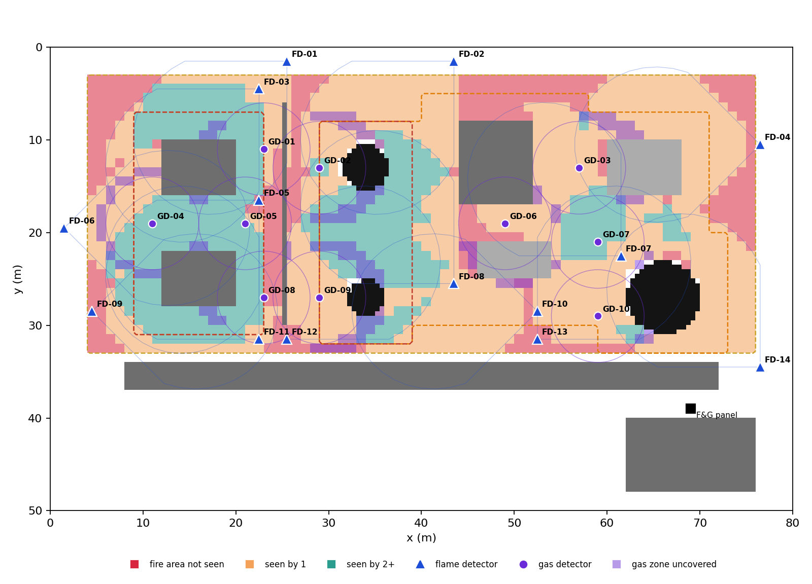
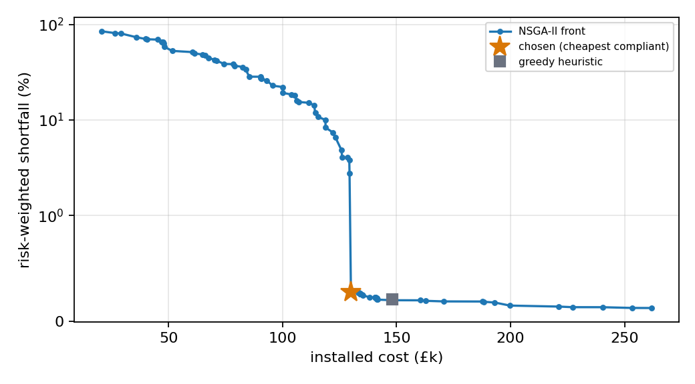
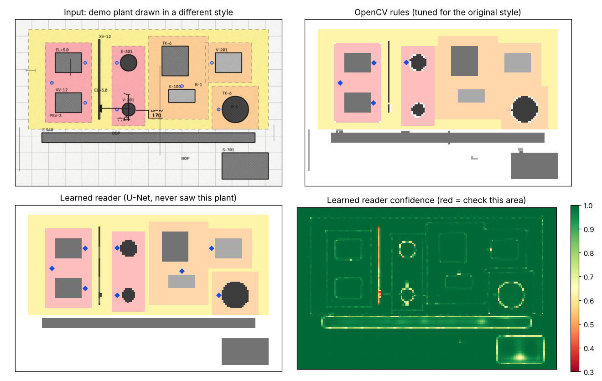

# DetectorPlace

**AI-assisted fire & gas detector placement, coverage validation and cost estimation.**

[](https://github.com/malikwaqas077/detectorplace/actions/workflows/ci.yml)

A working demonstrator built by Waqas Ahmad for the Teesside University × Protex (UK) Systems Knowledge Transfer
Partnership (KTP Associate, Software Engineer, ref T03269). It goes from a plot-plan drawing to an optimised,
explained and costed F&G detector layout:

```
CAD drawing (DXF) ──► layer mapping ───────────┐
                                                ├─► 2.5D plant model ──► 3D line-of-sight coverage engine (Numba)
plot-plan image ──► OpenCV rules or U-Net ─────┘           │                              │
                    (with per-cell confidence)    quality flags ◄──────────────────────────┤
                                                                                          ▼
       PDF design report ◄── explainability, N-1, gaps ◄── NSGA-II cost-vs-risk optimiser
                                                              (validated against greedy + exact MILP)
```

▶ **Demo video:** see the [v0.1.0 release](https://github.com/malikwaqas077/detectorplace/releases/tag/v0.1.0) (about 2 minutes)

> Everything here is synthetic: the plant is an invented gas compression station, and detector performance
> and cost figures are placeholders. The output is advisory and is not a substitute for a competent F&G engineer.



## Results on the demo plant

| | |
|---|---|
| Drawing → model (OpenCV) | equipment IoU **99.3%**, elevation bands 100% correct, hazard grades 98.6% agreement, 8/8 leak sources found |
| Coverage engine | **8.3 M** 3D sight-line checks in **0.6 s** (4,432 flame configurations × 1,827 fire points, plus gas) |
| Chosen layout | **14 flame + 10 gas detectors, £129,980** installed (excluding £18k fixed panel/engineering) |
| vs greedy heuristic | £148,048, so the GA is **12.2% cheaper** |
| vs exact MILP (HiGHS, 600 s) | best layout found £129,560, proven lower bound **£119,384**. The GA (in 135 s) is within 0.3% of the MILP's best layout and 8.9% of the bound, and it returns the whole cost-risk front, not one point |
| Re-checked on the true geometry | A1 98.7%, A2 77.2%, B1 87.3%, C1 68.1%, G1 82.6% (every target still met) |
| N-1 | cost-minimal layout, so losing any one of the 24 detectors drops at least one requirement below target. This is reported, not hidden; N-1 compliance can be added as a constraint |



Coverage targets (illustrative, structured like ISA-TR84.00.07 performance-based mapping):

| Requirement | Target | Achieved |
|---|---|---|
| Grade A fire, 1ooN | 90% | 99.1% (true geometry 98.7%) |
| Grade A fire, 2ooN | 75% | 77.9% (true geometry 77.2%) |
| Grade B fire, 1ooN | 85% | 88.6% (true geometry 87.3%) |
| Grade C fire, 1ooN | 60% | 66.2% (true geometry 68.1%) |
| Gas release zones, 1ooN | 80% | 82.3% (true geometry 82.6%) |

The optimiser works to target + 2% so that small errors in reading the drawing can't push the real plant
below target. The "true geometry" column above checks that this margin worked.

## v0.2: CAD input, a learned drawing reader, and quality flags

The v0.1 results above are unchanged: a re-run of v0.2 gives the same GA layout (£129,980), greedy cost, true-geometry coverage and N-1 result. The time-limited MILP depends on the machine: on a 2-core cloud box its 600 s run found £129,504 with a bound of £120,232, so the GA is within 0.4% of that run's best. v0.2 adds three things, aimed at the
question "the maths is exact, but what if the plant model is wrong?"

**1. CAD input.** `cad.py` reads a DXF plot plan by layer: closed `EQUIP*` outlines with height from the entity
thickness (or an `_H9` layer suffix), `HAZ_A/B/C` areas, `LEAK` points and the `FG_PANEL`. It handles mm, cm, m,
inches and feet, flips CAD's y axis, ignores grid, text and title-block layers, and reports anything it had to
assume. The demo plant exported to DXF (`samples/demo_plant.dxf`, in mm) reads back with hazard grades 100% and
heights 99.9% identical to the source. `samples/second_plant.dxf` is a different plant with deliberate problems
for the checks to find.

**2. A learned drawing reader.** There is no public dataset of industrial plot plans labelled with equipment
heights, hazard grades and leak sources, so the training data is generated (`scene.py`): 2,000 invented plants,
each drawn in a random style (shades, tints, outlines, hatching, grids, text, dimension lines, title blocks,
noise, blur, JPEG), with line art from real P&ID sheets
([mgupta70/PID_Symbol_Detection](https://github.com/mgupta70/PID_Symbol_Detection), MIT) pasted in as clutter.
Labels come free from the geometry. A small U-Net (`segnet.py`, 0.39 M parameters, 1.5 MB, trained in 33 minutes
on 2 CPU cores) outputs per-cell elevation band, hazard grade and a leak-source heatmap, each with a confidence.
The demo plant was never used in training.

| Reader | Test set | Equipment IoU | Height band | Hazard grade | Leak sources found | False leaks / drawing |
|---|---|---|---|---|---|---|
| OpenCV rules | 150 unseen plants, random styles | 92.5% | 99.6% | 98.8% | 82.5% | 0.00 |
| **Learned (U-Net)** | 150 unseen plants, random styles | **98.4%** | **99.8%** | **99.9%** | **99.8%** | 0.17 |
| OpenCV rules | demo plant, original style | 99.3% | 100% | 98.6% | 8/8 | 0 |
| **Learned (U-Net)** | demo plant, original style | **99.8%** | 100% | **100%** | 8/8 | 0 |
| OpenCV rules | demo plant, different style | 96.3% | 98.4% | 98.3% | **4/8** | 0 |
| **Learned (U-Net)** | demo plant, different style | **99.7%** | 98.9% | **100%** | **8/8** | 0 |



Why it matters end to end. The demo plant drawn in the different style, optimised for 80 generations and then
re-checked on the true geometry ([`docs/v02_end_to_end.json`](docs/v02_end_to_end.json)):

| Input → reader | Layout | Cost | Targets met on the true plant |
|---|---|---|---|
| Image → OpenCV rules | 14 flame + 6 gas | £114,220 | **3 of 5**: it missed half the leak sources, so gas coverage is really 44% against an 80% target |
| Image → learned reader | 15 flame + 11 gas | £139,080 | **5 of 5** |
| CAD file | 15 flame + 10 gas | £136,036 | **5 of 5** |

The cheap OpenCV layout looks fine on its own model. It is only wrong because the model is wrong, which is
exactly the failure the quality flags exist to catch: here they report the disagreement between the two
readers and the targets that fail on re-check.

**3. Quality flags** (`checks.py`, tab 6 in the app and section 9 of the report). Errors and warnings for: low
reader confidence (with a confidence map), disagreement between the OpenCV and learned readings of the same
drawing, missing or open CAD outlines, missing heights, unset units, no hazard areas or leak sources, an
implausible scale, targets met by less than the design margin, targets that fail when the layout is re-checked
on the other model, and placeholder detector data. As a sanity check, real P&ID sheets fed in as if they were plot
plans raise errors (28% low-confidence area, or no hazard areas found) rather than producing a design.

What this does not show: the learned reader is trained on one drawing convention (shade = elevation, tint =
grade). A real deployment would retrain or fine-tune it on Protex's own CAD exports and drawing standard, and the
CAD route should be preferred whenever a DXF exists.

## What is in the box

| Module | What it does |
|---|---|
| `plant.py` | 2.5D plant model (height map, hazard grades, leak sources) and a synthetic plot-plan renderer |
| `vision.py` | Reads the drawing back: HSV segmentation, morphology, connected components, elevation from fill shade, zone tints, leak markers. Ignores text, grid lines and noise. Scored against ground truth. |
| `detectors.py` | Detector catalogue (IR3 flame: range, horizontal/vertical cones, off-axis loss; point IR gas: radius), candidate positions × 2 mounting heights × 8 orientations, routed-cable cost model |
| `coverage.py` | Numba-parallel 3D ray marching: range, cones, off-axis loss and obstruction by equipment along the 3D sight line |
| `evaluate.py` | Per-grade 1ooN / 2ooN coverage targets, risk-weighted shortfall, feasibility |
| `nsga2.py` | NSGA-II written from scratch: integer chromosome (position → off / height × orientation), non-dominated sorting, crowding, greedy repair + redundancy pruning (memetic) |
| `baselines.py` | Greedy cost-effectiveness heuristic, and an exact mixed-integer program (SciPy/HiGHS) giving a provable lower bound |
| `explain.py` | Detector schedule with a plain-English reason for each detector, N-1 failure analysis, residual gaps with the reason they are uncovered (shadowed vs. cost trade-off) |
| `cad.py` | DXF reader (layer convention, units, y-flip, polygon rasterising, read report) and writer |
| `scene.py` | Random plants and randomised drawing styles with free labels, for training and stress tests |
| `segnet.py` | Learned drawing reader: U-Net segmentation of elevation band, hazard grade and leak heatmap, with confidence |
| `checks.py` | Quality flags on the input, the reading and the result |
| `report.py` + `templates/` | Fills a standard company report template and renders a PDF ([sample](docs/sample_report.pdf)) |
| `app.py` | Streamlit UI: drawing → model, interactive single-detector line of sight, Pareto front, design review, report download |

## Run it

```bash
pip install -r requirements.txt
python scripts/precompute.py 120 600   # optional: full run incl. a 10-minute MILP, cached for the UI
streamlit run app.py
pytest -q                              # 20 tests: geometry, vision, CAD round-trip, learned reader, checks, GA, baselines
python scripts/train_segnet.py 2000 6000   # optional: retrain the learned reader (about 35 min on 2 CPU cores)
python scripts/eval_readers.py 150         # compare both readers on unseen drawings
```

## Honest limitations, and what a real project needs

* **Geometry is 2.5D.** Equipment is extruded footprints. There are no open structures (you can't see under pipe
  racks) and no congestion inside modules. The next step is real 3D (point clouds or CAD/IFC) with a BVH-accelerated ray caster.
* **Detector physics is idealised.** A cone with quadratic off-axis loss stands in for certified polar diagrams per
  fuel and fire size (e.g. FM 3260 data). Gas detection uses a fixed cloud radius, not dispersion modelling or CFD.
* **Targets and costs are assumptions.** On a real project they come from the site F&G philosophy, hazard
  analysis and company estimating norms.
* **The MILP is time-limited.** It proves a lower bound but may not close the gap. The GA handles non-linear
  extensions (shared cable runs, detector diversity, maintenance access) that the MILP can't.
* **The learned reader has only seen synthetic drawings.** It generalises across drawing styles, but real
  company drawings need fine-tuning on a few labelled examples, and a CAD file should be used whenever one exists.
* **Validation needs real designs.** The industrial step is to compare against layouts Protex engineers have
  already approved and to keep a competent engineer in the loop for every design.

## Licence

MIT. Built by Waqas Ahmad · malikwaqas077@gmail.com · [LinkedIn](https://www.linkedin.com/in/waqas-ahmad09/)
